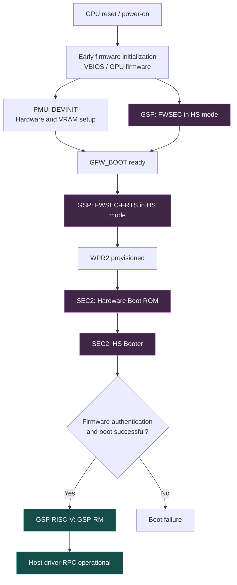
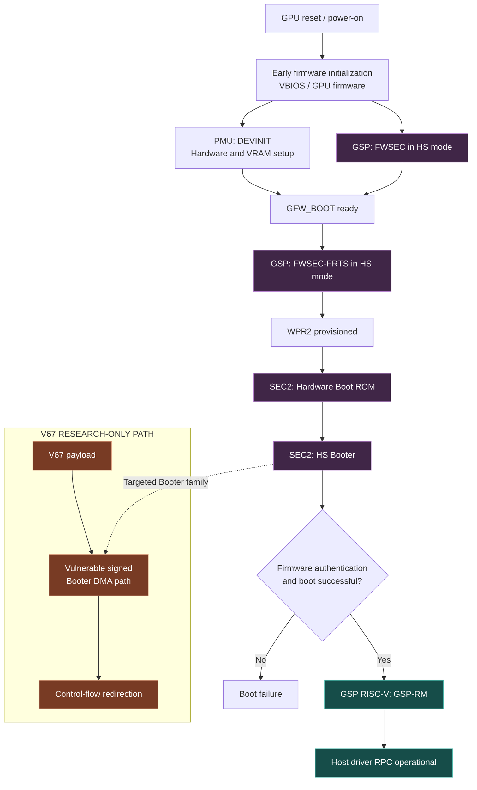

# NVIDIA Ampere and Ada Lovelace Pre-Driver Unlock Mechanism

> **Attribution & Scope**: This technical reference summarizes the GSP/SEC2 bootstrap sequence and Privilege Level Mask (`PLM`) transitions on NVIDIA Ampere (`GA10x`) and Ada Lovelace (`AD10x`) architectures based on the research published by **Jon Pry** (*"A Canary in the Crypto Mine"*, DOI `10.5281/zenodo.20916112`), **[Consensus-Protocol/cmp170hx](https://github.com/Consensus-Protocol/cmp170hx)**, **[WildFlash1st/cmp90hx-unlock](https://github.com/WildFlash1st/cmp90hx-unlock)**, **[TOTORONG/AD103_win_unlocker](https://huggingface.co/TOTORONG/AD103_win_unlocker)**, and **[Zagitta/gpu-unlock](https://github.com/Zagitta/gpu-unlock)**.

## 1. The Ampere and Ada Lovelace Boot Process

In both Nouveau and NVIDIA's open GPU kernel driver (`open-gpu-kernel-modules`), the standard GSP initialization sequence proceeds through six stages:

### 1.1. PCI Initialization
The host driver (or pre-boot UEFI loader) probes the PCIe function, maps Base Address Register 0 (`BAR0`) for Memory-Mapped I/O (`MMIO`) access, and allocates Direct Memory Access (`DMA`) buffers in host memory.

### 1.2. Firmware Loading
The host retrieves the required firmware images (`gsp_ga10x.bin`, `booter_load_*.bin`, and `gsp_boot_*.bin`), containing the GPU System Processor Resource Manager (`GSP-RM`), bootloaders, and auxiliary microcode.

### 1.3. Initial Hardware Setup
VBIOS-resident Firmware Security (`FWSEC`) and `DEVINIT` microcode initialize core hardware state, including VRAM training, clocks, and power sequencing during GPU reset/POST (`GFW_BOOT`).

### 1.4. Secure Boot Preparation (`FWSEC-FRTS`)
The host executes `FWSEC` Firmware Runtime Services (`FRTS`) from the board's VBIOS ROM on the GSP Falcon in Heavy-Secure (`HS`) mode, establishing a protected memory region (`WPR2`) at the top of VRAM.

### 1.5. GSP Bootstrap (`SEC2 Booter`)
The host loads a signed `Booter` image onto the Security Engine 2 (`SEC2`) Falcon processor. `SEC2` authenticates the signature in `WPR` metadata, prepares the GSP boot image inside `WPR2`, and releases the GSP RISC-V core.

### 1.6. Runtime Initialization
`GSP-RM` starts on the GSP processor, initializes GPU subsystems, and establishes shared-memory RPC queues with the host display driver.

## 2. The SEC2 Booter V67 Vulnerability

During the `SEC2` bootstrap stage, `SEC2` executes the signed `Booter` microcode in Heavy-Secure (`Level 3`) privilege mode. Before verifying the GSP image signature, the `Booter` copies the RSA signature buffer from host DMA memory into `SEC2` Data Memory (`DMEM` base `0x0600`) using the transfer length specified in `WprMeta`.

In the `610.43.03` Booter revision, the bounds check on the signature length occurs *after* the DMA copy helper returns. Supplying a `0xfa00`-byte (64,000-byte) signature buffer overflows `DMEM` from `0x0600` through `0xffff`, overwriting the active stack frame (`DMEM 0xff30–0xffff`) while preserving the expected stack canary value (`0xff4c`) from the known global canary location (`0x6140` on `GA102`, `0x5f50` on `AD102`).

Because NVIDIA's `open-gpu-kernel-modules` archive included both production (`IMAGE_PROD`) and debug (`IMAGE_DBG`) Booter blobs, and the debug blobs were encrypted with a publicly documented AES test key (Key Index 37), upstream researchers were able to disassemble the Falcon `FUC5` instruction stream and identify Return-Oriented Programming (`ROP`) gadgets inside the signed production Booter.

The resulting **V67 payload** that the pre-driver unlock transaction uses chains existing instructions inside the authenticated `SEC2 Booter` to perform privileged 32-bit MMIO register writes (`MEMORY[target_register] = target_value`) from `Level 3` context before halting `SEC2` cleanly.

## 3. Unlocking: Speed-Select Registers and Privilege Level Masks (1-Write vs. 4-Write Chains)

The instruction issue rate of Streaming Multiprocessor (`SM`) execution units is governed by two feature-override speed-select registers:

| Name | Address | Cold Default (`GA102`) | Governs |
| :--- | :--- | :--- | :--- |
| `FEAT_OVR_SM_SPD` (`SS0`) | `0x0082381c` | `0x00000001` | Eight 4-bit fields covering `DP`, `FFMA`, `FMLA16`, `FMLA32`, and `IMLA0–3` |
| `FEAT_OVR_SM_SPD_1` (`SS1`) | `0x00823820` | `0x00000001` | One 4-bit field at `[3:0]`, attributed to `IMLA4` |

Each 4-bit nibble is encoded as:
- `bit 3` (`0x8`): Override enabled
- `bits 2:0`: Speed divider
  - `000` (`0`) = Full rate (`1/1`)
  - `001` (`1`) = Half rate (`1/2`)
  - `010` (`2`) = Quarter rate (`1/4`)
  - `011` (`3`) = Eighth rate (`1/8`)

Writing `0x88888888` to `SS0` (`0x0082381c`) and `0x00000008` to `SS1` (`0x00823820`) enables the override and sets every field's divider to `0` (full `1/1` issue rate). However, direct writes from the host CPU (`Level 0`) to `0x0082381c` and `0x00823820` are ignored by default because write access is restricted by Privilege Level Mask (`PLM`) registers.

As documented in the [Consensus-Protocol/cmp170hx PLM bitfield model](https://github.com/Consensus-Protocol/cmp170hx/blob/main/docs/unlock/privilege-level-masks.md#2-bit-encoding), a PLM register encodes access rights as:
- **Bits `[3:0] = READ_PROTECTION`**: One bit per privilege level (`L0`/`L1`/`L2`/`L3`). A set bit permits reads from that level.
- **Bits `[7:4] = WRITE_PROTECTION`**: One bit per privilege level (`L0`/`L1`/`L2`/`L3`). A set bit permits writes from that level.
- **Bits `[23:8] = SOURCE_ENABLE`**: Controls which on-die engines may issue transactions.

Both `SS0` and `SS1` are governed by `FEAT_OVR_PLM` at `0x00823804`, whose cold value is `0xffffff8f` (`0x8f` = `1000 1111` binary: readable by `L0–L3`, writable only by `L3` Heavy-Secure microcode).

### 3.1. Ampere (`GA10x`): 1-Write PLM Chain
On Ampere (`GA102`–`GA106`), the V67 payload (`v67-ga102-610.43.03.bin`) executes a single `Level 3` store that writes `0xffffffff` to `FEAT_OVR_PLM` (`0x00823804`). Once `FEAT_OVR_PLM` is opened to `0xffffffff`, the host (`L0`) writes `0x88888888` to `SS0` (`0x0082381c`) and `0x8` to `SS1` (`0x00823820`), then issues a PCIe Function Level Reset (`FLR`) so the stock NVIDIA driver can initialize the GPU cleanly while `SS0`/`SS1` retain their unlocked values.

### 3.2. Ada Lovelace (`AD10x`): 4-Write PLM Chain
On Ada Lovelace (`AD102`–`AD107`), the payload (`v67-ad102-610.43.03-four-plm.bin`, constructed by `TOTORONG/AD103_win_unlocker`) executes four sequential `Level 3` permission stores inside the `AD102` `SEC2 Booter`:
1. `WPR_CFG PLM` (`0x001fa7cc`) $\leftarrow$ `0xfffff0ff`
2. `FBPA PLM` (`0x009a0148`) $\leftarrow$ `0xffffffff` *(observational; remains `0xffffff0f` on tested retail Ada boards)*
3. `WPR PLM` (`0x001fa7c4`) $\leftarrow$ `0xffffffff`
4. `FEAT_OVR_PLM` (`0x00823804`) $\leftarrow$ `0xffffffff`

After completing the four stores, the chain writes the completion marker `0x67b00001` into `FALCON_MAILBOX0` (`0x00840040`) and halts `SEC2` (`CPUCTL = 0x10`). The host driver/UEFI loader verifies the marker, `SEC2 HALT`, and the required permission readbacks, writes `SS0 = 0x88888888` and `SS1 = 0x8`, verifies that the effective hardware speed-select readout (`0x00823818`) drops to `0x00000000`, and performs a `PCIe FLR` before handing the card off to the unmodified NVIDIA driver.